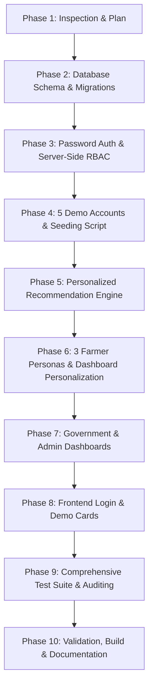

# KrishiSetu — Role-Based Access Control (RBAC), Demo Accounts & Personalized Recommendation Engine Plan

**Document Version:** 1.0.0  
**Target Platform:** KrishiSetu (Chhattisgarh Agricultural Transparency Platform)  
**Architecture:** Next.js 16 (Turbopack/React 19) + FastAPI (Python 3.11+) + SQLite (`backend/krishisetu.db`) + Hybrid In-Memory RAG  

---

## 1. Executive Summary & Existing Architecture Audit

### 1.1 Existing Architecture
- **Frontend:** Next.js 16 App Router located in `frontend/`, styled with Tailwind CSS, custom liquid glass aesthetic, multilingual support (`en`, `hi`, `hne`), and role layouts (`/farmer/*`, `/officer/*`, `/admin/*`).
- **Backend:** FastAPI application located in `backend/app/`, with modular routers:
  - `auth`: Basic OTP verification and legacy 3-role demo login.
  - `farmers`: `/me`, `/me/dashboard` returning user and farmer details.
  - `schemes`: `/schemes` returning government schemes and `/private-schemes` returning verified private lender loans.
  - `officer_admin`: Endpoints for reviewing applications, grievances, cultivator verifications, discrepancies, and audit logs.
  - `voice` & `rag`: AI telephony and BM25 policy retrieval.
- **Database:** SQLite (`backend/krishisetu.db`), accessed via synchronous thread-safe helpers in `backend/app/db/store.py`.

### 1.2 Identified Gaps & Required RBAC Evolution
1. **Authentication:**
   - Previous system relied on demo OTPs (`123456`) and mobile numbers without password-based authentication, salted password hashing, or password reset capability.
   - Demo login had only 3 generic roles rather than 5 distinct, persona-grounded demo accounts.
2. **Access Control (Server-Side RBAC):**
   - While routes checked `require_role()`, cross-farmer IDOR prevention was incomplete (farmers could theoretically query data by ID).
   - Government officers lacked administrative scope boundaries (district/block scoping).
3. **Farmer Profiles & Recommendations:**
   - There was only one hardcoded seed farmer (Ramesh Kumar).
   - Farmer dashboard rendered static or unpersonalized scheme lists rather than running a deterministic rule-based recommendation engine evaluating acreage, cultivator type (landowner vs tenant), crop, and district.
4. **Audit Logging:**
   - Audit logging existed for some officer actions, but lacked user management, authentication events, and role updates.

---

## 2. User Roles & Permission Matrix

| Permission / Capability | Farmer | Government Officer | Administrator |
| :--- | :---: | :---: | :---: |
| **Self-Registration (Password + Mobile/Email)** | ✅ | ❌ (Admin-provisioned) | ❌ (Admin-provisioned) |
| **1-Click Demo Login (5 Accounts)** | ✅ (Farmer 1, 2, 3) | ✅ (Officer) | ✅ (Admin) |
| **View Own Farmer Dashboard & Profile** | ✅ | ❌ | ❌ |
| **Update Own Profile Data** | ✅ | ❌ | ❌ |
| **Receive Personalized Scheme Recommendations** | ✅ | ❌ | ❌ |
| **View Own Applications & Benefits (Digital Twin)** | ✅ | ❌ | ❌ |
| **File Grievances & Upload Evidence** | ✅ | ❌ | ❌ |
| **View Farmers in Assigned Scope (District/Block)** | ❌ | ✅ | ✅ (All) |
| **Review Applications & Update Workflow Stage** | ❌ | ✅ | ✅ |
| **Review Cultivator Verification Evidence** | ❌ | ✅ | ✅ |
| **Resolve Discrepancies & Grievances** | ❌ | ✅ | ✅ |
| **Manage Users & Role Assignment** | ❌ | ❌ | ✅ |
| **Create/Archive Schemes & Policies** | ❌ | ❌ | ✅ |
| **Inspect System Audit Logs** | ❌ | ❌ | ✅ |
| **Cross-Farmer IDOR Access** | ❌ (Blocked) | ❌ (Scope-checked) | ✅ (Super-admin) |

---

## 3. Database Schema Extensions

### 3.1 `users` Table Enhancement
- Add `email TEXT UNIQUE`
- Add `password_hash TEXT` (PBKDF2-HMAC-SHA256 with per-user salt)
- Add `updated_at TEXT`

### 3.2 `farmers` Table Enhancement
- Add `landholding_acres REAL`
- Add `irrigation_type TEXT` ('partially_irrigated', 'irrigated', 'rainfed')
- Add `cultivation_type TEXT` ('landowner', 'tenant', 'sharecropper')

### 3.3 `government_profiles` Table (New)
- `id TEXT PRIMARY KEY`
- `user_id TEXT UNIQUE NOT NULL REFERENCES users(id)`
- `department TEXT NOT NULL`
- `designation TEXT NOT NULL`
- `state TEXT NOT NULL`
- `district TEXT NOT NULL`
- `block TEXT`
- `employee_reference TEXT`
- `created_at TEXT NOT NULL DEFAULT CURRENT_TIMESTAMP`
- `updated_at TEXT NOT NULL DEFAULT CURRENT_TIMESTAMP`

### 3.4 `farmer_scheme_recommendations` Table (New)
- `id TEXT PRIMARY KEY`
- `farmer_id TEXT NOT NULL REFERENCES users(id)`
- `scheme_id TEXT NOT NULL REFERENCES schemes(id)`
- `recommendation_score REAL NOT NULL`
- `eligibility_status TEXT NOT NULL` ('eligible', 'potentially_eligible', 'missing_information', 'not_eligible')
- `reason TEXT NOT NULL`
- `matched_conditions TEXT NOT NULL` (JSON array)
- `unmet_conditions TEXT NOT NULL` (JSON array)
- `missing_documents TEXT NOT NULL` (JSON array)
- `recommendation_type TEXT NOT NULL` ('government', 'private_loan', 'private_insurance', 'machinery')
- `generated_at TEXT NOT NULL DEFAULT CURRENT_TIMESTAMP`
- `rules_version TEXT NOT NULL DEFAULT '2026-CG-RULES-01'`

---

## 4. Five Seeded Demo Accounts Strategy

Controlled by environment variable `ENABLE_DEMO_LOGIN=true`.

| Account | Email / Identifier | Password | Role | Persona & Focus |
| :--- | :--- | :--- | :--- | :--- |
| **Farmer 1** | `farmer1@krishisetu.demo` / `9876543210` | `DemoFarmer1@2026` | `farmer` | **Ramesh Kumar** (KS-FARM-001): 2 acres, Raipur/Arang, Paddy & vegetables, Landowner. Small-farmer subsidies, PM-KISAN, PMFBY, KCC credit. |
| **Farmer 2** | `farmer2@krishisetu.demo` / `9876543211` | `DemoFarmer2@2026` | `farmer` | **Suresh Verma** (KS-FARM-002): 5 acres, Durg/Patan, Paddy & maize, Landowner, Irrigated. Farm mechanization (tractor finance), micro-irrigation (Saur Sujala, drip), commercial KCC. |
| **Farmer 3** | `farmer3@krishisetu.demo` / `9876543212` | `DemoFarmer3@2026` | `farmer` | **Mohan Sahu** (KS-FARM-003): 3 acres, Bilaspur/Takhatpur, Paddy & pulses, Tenant / Sharecropper, Rain-fed. Cultivator lease certification, tenant-eligible crop loans; strict landowner schemes flagged as ineligible. |
| **Government** | `officer@krishisetu.demo` / `9876500001` | `DemoOfficer@2026` | `officer` | **Anita Verma**: Agricultural Extension Officer, Department of Agriculture, Raipur district scope. Case review, discrepancy resolution, evidence verification. |
| **Admin** | `admin@krishisetu.demo` / `9876500002` | `DemoAdmin@2026` | `admin` | **System Administrator**: Full platform governance, user management, policy rules, and system audit log inspection. |

---

## 5. Personalized Recommendation Engine Architecture

### 5.1 Deterministic Evaluation Pipeline
Input: Farmer Profile ($State, District, Acreage, CultivatorType, Crops, Irrigation, Category$).
Output: Ranked Scheme & Loan Recommendations with explicit reasoning.

1. **Location Applicability:** Verify state and district rules (e.g., Central + Chhattisgarh state-specific programs like Rajiv Gandhi Kisan Nyay, Godhan Nyay, Saur Sujala).
2. **Cultivator Status & Landholding Criteria:**
   - Small & marginal ($< 5$ acres) vs medium ($5-10$ acres).
   - Strict Landowner Requirement: Flagged for tenant farmers with transparent explanation and alternative cultivator-friendly programs.
3. **Crop & Irrigation Matching:**
   - Paddy / Maize / Pulses specific schemes.
   - Irrigated vs Rain-fed subsidies (e.g. Saur Sujala solar pump recommendations for rain-fed/partially irrigated land).
4. **Private Financial Products Classification:**
   - Separated into Bank Loans (SBI Kisan Gold Card, Baroda KCC), Equipment Financing (Mahindra Tractor Loan), and Crop Insurance (Bajaj Allianz).

---

## 6. Implementation Phases & Roadmap

---

## 7. Security Considerations
- **Password Storage:** Hashed using PBKDF2-HMAC-SHA256 with unique 16-byte cryptographic salts. Plaintext passwords never stored or logged.
- **Demo Login Safety:** No client-supplied passwords; demo endpoint authenticates purely server-side based on pre-seeded identities and requires `ENABLE_DEMO_LOGIN=true`.
- **IDOR Protection:** All `/farmers/me/*` routes resolve identity directly from the authenticated session user ID, preventing cross-tenant data access.
- **Scope Enforcement:** Government officer queries enforce district/block scoping.
- **Audit Trails:** All status modifications and admin actions recorded in `audit_logs`.

---

## 8. Acceptance Criteria Checklist
- [x] Phase 1 Plan document created (`docs/RBAC_IMPLEMENTATION_PLAN.md`).
- [ ] Database schema migrations executed idempotently.
- [ ] Password registration, login, logout, and session persistence working.
- [ ] Five demo accounts seeded and accessible via 1-click cards on login page.
- [ ] 3 Farmer personas receive distinct, accurate scheme and loan recommendations.
- [ ] Tenant farmer (Farmer 3) correctly identified for lease-eligible schemes while flagged for landowner-only schemes.
- [ ] Government and Admin dashboards operational with server-side role protection.
- [ ] Automated tests cover authentication, RBAC, IDOR prevention, and recommendation logic.
